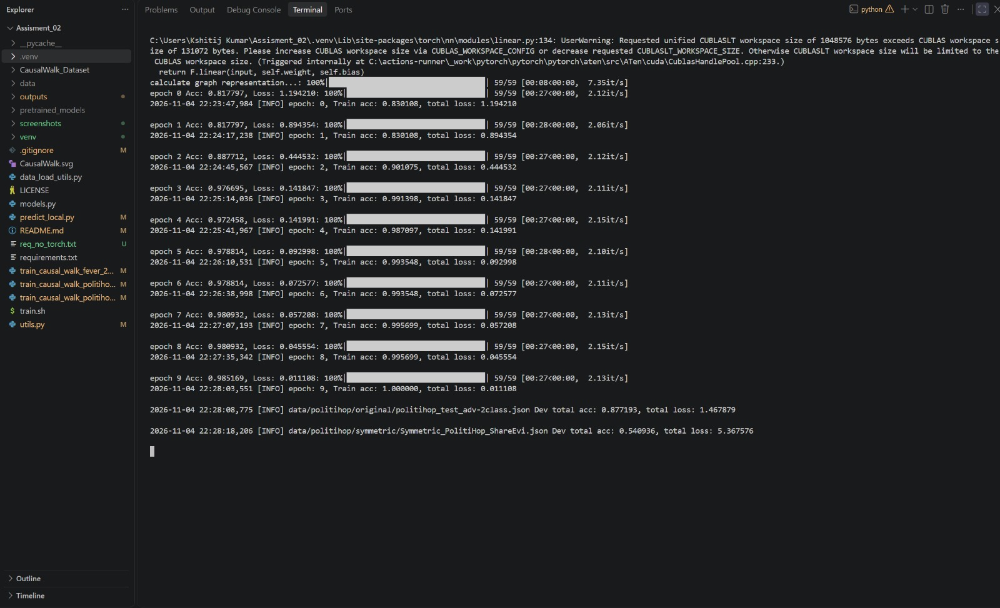
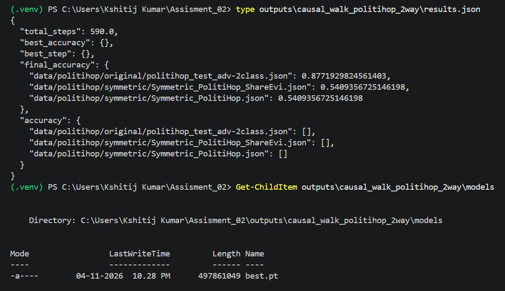

# Causal Walk
Code and data for our paper "[Causal Walk: Debiasing Multi-hop Fact Verification with Front-door Adjustment](https://doi.org/10.1609/aaai.v38i17.29925)" in AAAI 2024.


# Download
To reproduce the results in the paper, you need to download the dataset and our pre-trained model from [here](https://drive.google.com/drive/folders/19IdPsf0hZCnoHVnfHIelzEmnbkU3EF_6?usp=sharing).

Then you should organize them in the following format.
```
CausalWalk
    ├── data
    ├── pretrained_models
    ├── outputs
    ├── data_load_utils.py
    ├── models.py
    ├── train_causal_walk_fever_2way.py
    ├── train_causal_walk_politihop_2way.py
    ├── train_causal_walk_politihop_3way.py
    ├── train.sh
    └── utils.py
```
The dataset files are read as JSON Lines (one JSON example per line). Keep the
pretrained BERT folder and graph-representation checkpoint files in
`pretrained_models/`; they are not included in this repository.
The checked-in `outputs/` logs and JSON files are pre-existing run artifacts;
they were produced before the fixes below and are not results from the corrected
training code. Re-run training to produce current results and a `models/best.pt`
checkpoint.

# Environment
Use Python 3.10 or 3.11, then install the project dependencies.
```
pip install -r requirements.txt
```
On Windows PowerShell, create an isolated Python 3.11 environment with:
```powershell
py -3.11 -m venv .venv
.\.venv\Scripts\Activate.ps1
python -m pip install --upgrade pip
python -m pip install -r requirements.txt
```

# Reproduction
Trained on the FEVER dataset and evaluated on Adversarial FEVER. (2-way)
```
CUDA_VISIBLE_DEVICES="0" python train_causal_walk_fever_2way.py \
--seed 1234 \
--batch_size 16 \
--lr 2e-5 \
--epochs 20 \
--weight_decay 5e-4 \
--evi_num 5 \
--max_seq_length 128
```
On Windows, run one experiment from the repository root (the script automatically
uses CUDA when available and CPU otherwise):
```powershell
python .\train_causal_walk_fever_2way.py --seed 1234 --batch_size 16 --lr 2e-5 --epochs 20 --weight_decay 5e-4 --evi_num 5 --max_seq_length 128 --overwrite
python .\train_causal_walk_politihop_3way.py --seed 1234 --batch_size 4 --lr 1e-5 --epochs 20 --weight_decay 5e-4 --evi_num 20 --max_seq_length 128 --overwrite
python .\train_causal_walk_politihop_2way.py --seed 1234 --batch_size 4 --lr 1e-5 --epochs 10 --weight_decay 5e-4 --evi_num 20 --max_seq_length 128 --overwrite
```
Run only the experiment you need. The 2-way PolitiHop run has no separate validation file in
its configured data paths, so it saves the final epoch checkpoint. The FEVER and
3-way PolitiHop runs select the checkpoint using their first validation dataset;
test datasets do not select checkpoints. `results.json` records validation scores
per epoch under `accuracy` (empty for 2-way PolitiHop) and evaluates the selected
checkpoint once on every configured dataset under `final_accuracy`.
Trained on the PolitiHop dataset and evaluated on Adversarial PolitiHop. (3-way)
```
CUDA_VISIBLE_DEVICES="0" python train_causal_walk_politihop_3way.py \
--seed 1234 \
--batch_size 4 \
--lr 1e-5 \
--epochs 20 \
--weight_decay 5e-4 \
--evi_num 20 \
--max_seq_length 128 
```
Trained on the PolitiHop dataset and evaluated on Symmetric PolitiHop. (2-way)
```
CUDA_VISIBLE_DEVICES="0" python train_causal_walk_politihop_2way.py \
--seed 1234 \
--batch_size 4 \
--lr 1e-5 \
--epochs 10 \
--weight_decay 5e-4 \
--evi_num 20 \
--max_seq_length 128 
```

# Local prediction demo
Download and place the datasets and pretrained files as described above. Train one of
the models below first so its fine-tuned checkpoint is saved under
`outputs/<experiment>/models/`. If that experiment already has a `results.json`,
pass `--overwrite` to train again and generate fresh checkpoints.

Start the local web app from the repository root:
```
python predict_local.py
```
Then open `http://127.0.0.1:8000`. Select the model, enter a claim, and paste one
evidence sentence per line. The first prediction may take time while the app loads
the model and computes training-set cluster centers. The server binds to localhost
by default and does not expose itself to the network.

# Citation
```
@inproceedings{zhang2024causal,
  title={Causal Walk: Debiasing Multi-Hop Fact Verification with Front-Door Adjustment},
  author={Zhang, Congzhi and Zhang, Linhai and Zhou, Deyu},
  booktitle={Proceedings of the AAAI Conference on Artificial Intelligence},
  volume={38},


  number={17},
  pages={19533--19541},
  year={2024}
}
```

## Screenshots(output)


## Execution Results

Ran on Python 3.11 with torch 2.11.0+cu128 because the pinned torch 2.1.0 does
not support the RTX 5060.

Code changes made for this run:
- Set `weights_only=False` in `torch.load` calls.
- Moved `import torch` to the first line in `train_causal_walk_politihop_2way.py`
  and `utils.py`.

### Training run -> 

### Final accuracy -> 

### Local demo

Demo screenshot pending.
